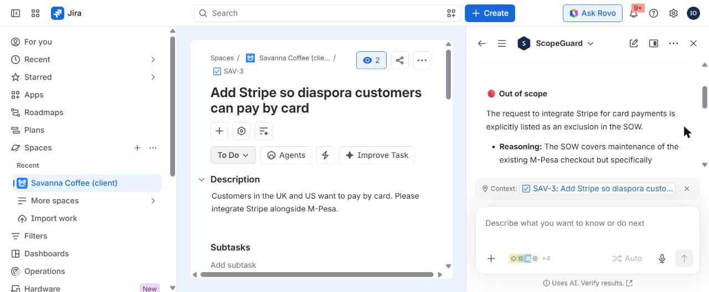

# ScopeGuard

**Bill it before you build it.** ScopeGuard is an Atlassian Forge app and Rovo agent that protects the margins of agencies and freelancers who deliver client work in Jira. It reads the client's signed statement of work (SOW) from Confluence, checks every new ticket against it, tracks retainer hours and SLAs, and turns out-of-scope requests into change orders that a person approves before anything reaches the client.

Built for **Codegeist 2026** (Apps for Business Teams, plus the Rovo agent bonus).



## The problem

Small agencies and freelancers lose money in two quiet ways. A client sends "a quick request" that was never in the contract, and the team just does it. A retainer runs out on the 20th and nobody notices until the invoice dispute. The SOW sits in Confluence, the work happens in Jira, and the two never meet. In Nairobi, where many studios run on monthly retainers billed in KES, a single unbilled feature can wipe out a month's margin.

## What it does

| Where | What you get |
| --- | --- |
| **Rovo agent "ScopeGuard"** | Ask "Is this ticket in scope?", "How much retainer is left?", "Which open requests look like scope creep?" or "Draft a change order for this issue". The agent calls ScopeGuard's actions, reads the SOW clauses itself, and cites the clause that decides the answer. |
| **Jira issue panel** | Verdict lozenge (In scope / Out of scope / Needs review), the matching SOW clause with a link to the Confluence page, an SLA timer by priority, and a "Bill it before you build it" form that drafts a change order priced at the contract rate. |
| **Approval gate** | Change orders are always created as *pending*. Only a person who can edit issues in the project can approve them. Approving publishes a change-order page under the SOW in Confluence and records the decision as a Jira comment. Neither the agent nor the app can approve anything on its own. |
| **Auto-flag trigger** | When a new issue is created, ScopeGuard checks it against the SOW. Out-of-scope requests get a `scope-creep` label and an explanatory comment before anyone starts work. |
| **Project dashboard** | Retainer burn for the month (with projection and overage cost), a list of requests the SOW does not clearly cover, an SLA watchlist and a change-order ledger. |
| **Rovo MCP tools** | The same five actions are exposed through `rovo:mcp`, so customers can add them to their own agents in Rovo Studio. |

## How it works

```
Confluence SOW page ──► parseSow() ──► Contract { inScope, outOfScope, retainer, rate, SLA }
                                              │
Jira issue ──► classifyScope() ◄──────────────┤   deterministic, auditable first pass
          └──► slaStatus()     ◄──────────────┤
Jira worklogs ──► computeBurn() ◄─────────────┘
                                              │
Rovo agent ──► actions (get-contract, check-scope, get-retainer, scan-project, draft-change-order)
                 └─ the LLM reads the clauses and the issue, agrees or disagrees, and explains
Human ──► Approve in the issue panel ──► Confluence change-order page + Jira comment
```

* **Runs on Atlassian.** Everything runs inside Forge: functions, Forge KVS storage, UI Kit, Rovo. No external servers and no third-party AI keys. The scope check is plain TypeScript, so it is fast, free and explainable, and the Rovo agent adds the judgement on top.
* **Trusted inputs only.** Resolvers take issue and project keys from the Forge extension context, never from the client payload. Agent inputs are validated with Zod and fall back to the deterministic Rovo context. Approvals and settings changes check the signed-in user's own Jira permissions (`asUser`).
* **Graceful degradation.** If Confluence is not connected, paste the SOW text instead. If Confluence page creation fails, the approval still stands and is recorded in Jira.

## SOW format

ScopeGuard reads simple headings and bullets, which most agency SOWs already use:

```
Client: Savanna Coffee Co.
Retainer: 40 hours / month
Rate: KES 6,500 / hour

## In scope
- Bug fixes on the existing Next.js storefront
- M-Pesa checkout maintenance and payment failures

## Out of scope
- Mobile app development (Android or iOS)
- New payment provider integrations such as Stripe or PayPal

## SLA
- Highest: 4 hours
- High: 8 hours
- Medium: 2 days
```

Headings such as "Deliverables", "Exclusions" and "Service levels" also work, and SLAs accept P1–P5. The settings page reports anything it could not find.

## Try it (judges)

1. Install ScopeGuard on your Jira site with the installation link on the Devpost page, then connect Confluence when Jira prompts you. ScopeGuard requires Jira; Confluence is optional.
2. In Confluence, create a page using the SOW format above, or copy [`docs/sample-sow.md`](docs/sample-sow.md).
3. In any Jira project, open the **ScopeGuard** tab (under the project's "More" menu), paste the Confluence page URL and click **Save and parse SOW**. A Jira admin or project admin must do this.
4. Create an issue such as "Build an Android app for coffee subscriptions". Within about 3 minutes (Forge event delivery time) it gets a `scope-creep` label and a comment.
5. Open the issue, open the **ScopeGuard** panel from the apps button, enter an estimate and click **Draft change order**, then **Approve and publish**. A change-order page appears under your SOW in Confluence.
6. Open Rovo chat, @mention **ScopeGuard** and ask "Is this ticket in scope?" or "Which open requests look like scope creep in SAV?".

## Development

Requirements: Node.js 22 or 24 LTS, the Forge CLI (`npm i -g @forge/cli`) and an Atlassian developer site.

```bash
npm install
npm test               # 43 unit and integration tests
npm run test:coverage  # ~99% line coverage on backend logic
npm run typecheck
forge register         # once, to create your own app id
forge deploy
forge install --product jira
forge install --product confluence
```

On Node.js 25, which Forge does not support yet, prefix Forge commands with `NODE_OPTIONS=--no-experimental-webstorage` so the bundler works.

```
src/
  domain/      pure logic: SOW parser, scope classifier, retainer burn, SLA, change orders
  services/    Jira, Confluence and KVS access, plus core.ts orchestration
  actions/     Rovo agent actions (also exposed as MCP tools)
  resolvers/   UI Kit resolver functions with permission checks
  triggers/    avi:jira:created:issue auto-flagging
  frontend/    UI Kit issue panel and project page
resources/agent/prompt.txt   Rovo agent prompt
test/          Vitest suites with an in-memory fake Jira, Confluence and KVS
```

## Roadmap

* Business-hours SLA calendars and first-response SLAs
* Retainer roll-over and multi-SOW clients
* Monthly client report page generated by the agent
* Marketplace listing

## License

[MIT](LICENSE) © 2026 Ian Ohuru
